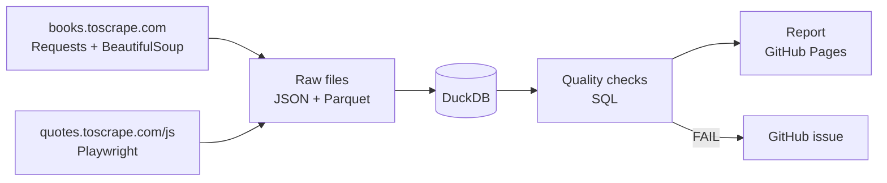

# web-data-quality-pipeline

Daily pipeline that scrapes two websites, loads the data into DuckDB, checks its quality and publishes a report.

**Latest report:** https://phuochuyy.github.io/web-data-quality-pipeline/

## Overview

- **Data:** [books.toscrape.com](https://books.toscrape.com) (static HTML: 100 books, each with its own page) and [quotes.toscrape.com/js](https://quotes.toscrape.com/js/) (page rendered by JavaScript: 50 quotes). Both sites are made for scraping practice.
- **Goal:** collect web data on a schedule and know every day whether it can be trusted: complete, unique, valid, consistent and fresh.
- **Output:** a DuckDB warehouse, an HTML report on GitHub Pages, and a GitHub issue when a check fails.

## Architecture



| Tool | Why |
|---|---|
| Requests + BeautifulSoup | static pages are plain HTML, no browser needed |
| Playwright | the quotes page only shows its content after JavaScript runs |
| JSON + Parquet | raw data is kept unchanged; Parquet is fast to load |
| DuckDB | a SQL warehouse in one file, no server to run |
| GitHub Actions | daily schedule, tests on every pull request, publishing the report |

## How it works

1. **Scrape:** read `robots.txt`, wait 1 second between requests, retry on errors. Books are read from the listing and from each book's own page.
2. **Store:** save the raw records as JSON and Parquet, one file per run.
3. **Load:** load the run into DuckDB. Re-running the same run does not create duplicates. Staging views trim text, remove duplicates and replace placeholder categories with `Uncategorized`.
4. **Check:** 26 SQL checks (below). A failed check turns the run red and opens a GitHub issue; the next good run closes it.
5. **Report:** write the results as Markdown and HTML and publish the HTML to GitHub Pages.

## Data quality

| Type | Example |
|---|---|
| Completeness | no missing title, price or UPC |
| Uniqueness | no duplicate books or quotes |
| Validity | price above 0, rating from 1 to 5 |
| Consistency | price and title on the listing match the book's own page |
| Freshness | last scrape less than 26 hours ago |
| Anomaly | row count within 30% of previous runs, unusual prices |

## How to run

Needs Python 3.10 or newer.

```bash
python -m venv .venv
source .venv/bin/activate            # Windows: .venv\Scripts\activate
pip install -e ".[dev]"
python -m playwright install chromium

wdq run       # scrape, load, check, report (about 2 minutes)
pytest -q     # 25 offline tests
```

The report is written to `reports/report.html`. Example: [`reports/example/report.md`](reports/example/report.md).

## Lessons learned

- **Two pages for the same book can be compared.** Checking the listing against each book's own page is a cheap way to test accuracy.
- **The source has placeholder values.** 14 of the first 100 books are filed under "Default" or "Add a comment". They are cleaned in staging and tracked with a threshold instead of failing every run.
- **Next steps:** more pages and sources, and keeping the warehouse history outside the CI cache.
