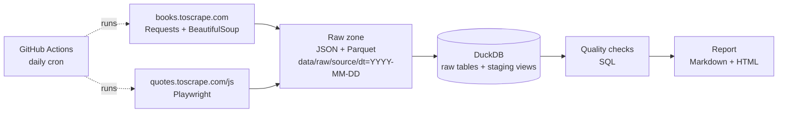

# web-data-quality-pipeline

A small, end-to-end web data pipeline: **scrape → raw files → DuckDB → data quality checks → automated report**, scheduled daily with GitHub Actions. Runs on Windows/Linux/macOS without Docker.

Sources are sites built for scraping practice: [books.toscrape.com](https://books.toscrape.com) (static HTML) and [quotes.toscrape.com/js](https://quotes.toscrape.com/js/) (rendered by JavaScript).

## Architecture



- **Polite scraping** (`src/wdq/client.py`): reads `robots.txt` (incl. `Crawl-delay`), waits ≥ 1 s between requests to the same host, retries 429/5xx with exponential backoff, logs every request.
- **Raw zone** (`storage.py`): untouched JSON (source of truth) + Parquet, partitioned by date and `run_id`.
- **Warehouse** (`warehouse.py`): idempotent load per `run_id`, a `pipeline_runs` table, and de-duplicated staging views.
- **Quality checks** (`quality.py`): completeness, uniqueness, validity, freshness, row-count anomaly vs. previous runs, price outliers (z-score). Any `FAIL` exits non-zero so the scheduled run turns red.
- **Report** (`report.py`): Markdown + HTML, also published to the GitHub Actions job summary.

## Run it

```bash
python -m venv .venv
# Windows: .venv\Scripts\activate   |   Linux/macOS: source .venv/bin/activate
pip install -e ".[dev]"
python -m playwright install chromium

wdq run            # scrape + load + check + report
wdq check          # checks + report only
pytest -q          # 15 offline tests (no network needed)
```

Output: `data/warehouse.duckdb`, `data/raw/...`, `reports/report.md`, `reports/report.html`.
Settings come from environment variables, e.g. `WDQ_BOOKS_PAGES=10`, `WDQ_MIN_INTERVAL=2` (see `src/wdq/config.py`).

## Example report

See [`reports/example/report.md`](reports/example/report.md). Excerpt:

| Status | Table | Check | Dimension | Observed | Expected |
|---|---|---|---|---|---|
| ✅ PASS | raw_books | not_null:price_gbp | completeness | 0 missing (0.0%) | <= 1% missing |
| ✅ PASS | raw_books | unique:url | uniqueness | 0 duplicate rows | 0 |
| ✅ PASS | raw_books | freshness | freshness | last scrape 0:00:13 ago | < 26h old |
| ✅ PASS | raw_books | row_count_vs_history | anomaly | 100 vs avg 100 (+0%) | within ±30% |

## How it maps to the job description

| Requirement | Where |
|---|---|
| Web scraping (BeautifulSoup, Playwright), Requests | `scrapers/books.py`, `scrapers/quotes_js.py`, `client.py` |
| Operating and monitoring collection jobs | logging, retries, `pipeline_runs` table, red CI run on `FAIL` |
| Data quality: completeness, accuracy, consistency, freshness, anomalies | `quality.py` |
| Cleaning and transformation, Python + SQL, Pandas | `storage.py`, staging views in `warehouse.py` |
| ETL/ELT, scheduling | `wdq run`, `.github/workflows/pipeline.yml` (daily cron) |
| Automated reports | `report.py` → Markdown/HTML + job summary |
| Git, tests | feature branches, pytest, CI on every push/PR |
