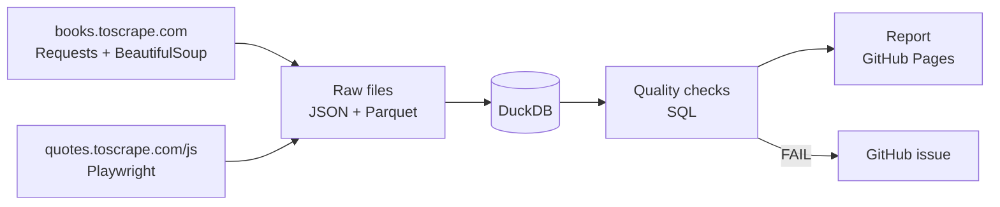

# web-data-quality-pipeline

Scrape two websites every day, load the data into DuckDB, check its quality and publish a report.

**Latest report:** https://phuochuyy.github.io/web-data-quality-pipeline/



## What it does

1. **Scrape** books (listing + each book's page) and quotes (a JavaScript page, rendered with Playwright). Respects `robots.txt`, waits 1 s between requests, retries on errors.
2. **Store** the raw data unchanged as JSON and Parquet, one file per run.
3. **Load** into DuckDB. Re-running the same run does not create duplicates. Staging views clean the data (trim, de-duplicate, placeholder categories → `Uncategorized`).
4. **Check** 26 rules per run (below). A `FAIL` turns the run red and opens a GitHub issue; the next good run closes it.
5. **Report** in Markdown and HTML, published to GitHub Pages. GitHub Actions runs everything daily.

## Quality checks

| Type | Examples |
|---|---|
| Completeness | no missing title, price, UPC |
| Uniqueness | no duplicate books or quotes |
| Validity | price > 0, rating 1–5 |
| Consistency | price and title on the listing = on the book's own page |
| Freshness | last scrape < 26 h ago |
| Anomaly | row count within ±30% of previous runs, price outliers |

## Run locally

```bash
python -m venv .venv && source .venv/bin/activate   # Windows: .venv\Scripts\activate
pip install -e ".[dev]"
python -m playwright install chromium

wdq run       # scrape + load + check + report (about 2 minutes)
pytest -q     # 25 offline tests
```

Output: `reports/report.html`. Example: [`reports/example/report.md`](reports/example/report.md).

## Stack

Python · Requests · BeautifulSoup · Playwright · pandas · DuckDB · pytest · ruff · GitHub Actions · GitHub Pages
