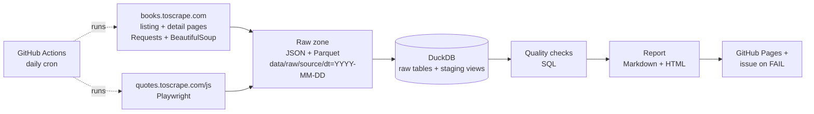

# web-data-quality-pipeline

A small, end-to-end web data pipeline: **scrape → raw files → DuckDB → data quality checks → automated report**, scheduled daily with GitHub Actions. Runs on Windows/Linux/macOS without Docker.

**Latest report (updated by every run): https://phuochuyy.github.io/web-data-quality-pipeline/**

Sources are sites built for scraping practice: [books.toscrape.com](https://books.toscrape.com) (static HTML) and [quotes.toscrape.com/js](https://quotes.toscrape.com/js/) (rendered by JavaScript).

## Architecture



- **Polite scraping** (`src/wdq/client.py`): reads `robots.txt` (incl. `Crawl-delay`), waits ≥ 1 s between requests to the same host, retries 429/5xx with exponential backoff, logs every request.
- **Two views of each book**: the catalogue listing (title, price, rating, in stock) and the book's own page (UPC, category, units in stock, price and title again), so the sources can be checked against each other. A failed detail page keeps the listing row; the completeness checks report the gap.
- **Raw zone** (`storage.py`): untouched JSON (source of truth) + Parquet, partitioned by date and `run_id`.
- **Warehouse** (`warehouse.py`): idempotent load per `run_id`, a `pipeline_runs` table, de-duplicated staging views; new columns are added in place to a warehouse from an older version.
- **Quality checks** (`quality.py`, 26 per run): completeness, uniqueness, validity, **consistency** (listing vs. detail page: price, title, in-stock flag vs. units, one UPC per page), freshness, row-count anomaly vs. previous runs, price outliers (z-score). `FAIL` exits non-zero so the scheduled run turns red; `WARN` is reported but does not fail the run.
- **Report** (`report.py`): Markdown + HTML, published to GitHub Pages and the job summary.
- **Alerting** (`.github/scripts/quality_issue.sh`): a failed run opens an issue labelled `data-quality` listing the failing checks (later failures comment on it); the next passing run closes it. The freshness SLA is `WDQ_MAX_AGE_HOURS` (default 26); a manual run with `freshness_sla_hours: 0` forces a FAIL to test this path.

## Run it

```bash
python -m venv .venv
# Windows: .venv\Scripts\activate   |   Linux/macOS: source .venv/bin/activate
pip install -e ".[dev]"
python -m playwright install chromium

wdq run            # scrape + load + check + report
wdq check          # checks + report only
pytest -q          # 23 offline tests (no network needed)
ruff check src tests
```

Output: `data/warehouse.duckdb`, `data/raw/...`, `reports/report.md`, `reports/report.html`.
Settings come from environment variables, e.g. `WDQ_BOOKS_PAGES=10`, `WDQ_MIN_INTERVAL=2`, `WDQ_BOOK_DETAILS=0` to skip detail pages (see `src/wdq/config.py`). A default run makes ~110 requests to books.toscrape.com at ≥ 1 s apart (about 2 minutes).

## Example report

See [`reports/example/report.md`](reports/example/report.md). Excerpt:

| Status | Table | Check | Dimension | Observed | Expected |
|---|---|---|---|---|---|
| ✅ PASS | raw_books | not_null:upc | completeness | 0 missing (0.0%) | <= 1% missing |
| ✅ PASS | raw_books | one_upc_per_url | consistency | 100 urls, 100 upcs, 100 pairs | 1:1 |
| ✅ PASS | raw_books | price_listing_eq_detail | consistency | 0 invalid rows | listing price = detail price |
| ✅ PASS | raw_books | in_stock_matches_stock_count | consistency | 0 invalid rows | in_stock = (stock_count > 0) |
| ⚠️ WARN | raw_books | category_not_placeholder | validity | 14 invalid rows | real category |
| ✅ PASS | raw_books | row_count_vs_history | anomaly | 100 vs avg 100 (+0%) | within ±30% |

The WARN is a real finding: 14 of the first 100 books are filed under the placeholder categories "Default" and "Add a comment".

## How it maps to the job description

| Requirement | Where |
|---|---|
| Web scraping (BeautifulSoup, Playwright), Requests | `scrapers/books.py`, `scrapers/quotes_js.py`, `client.py` |
| Operating and monitoring collection jobs | logging, retries, `pipeline_runs` table, red CI run and an auto-opened issue on `FAIL` |
| Data quality: completeness, accuracy, consistency, freshness, anomalies | `quality.py` |
| Cleaning and transformation, Python + SQL, Pandas | `storage.py`, staging views in `warehouse.py` |
| ETL/ELT, scheduling | `wdq run`, `.github/workflows/pipeline.yml` (daily cron) |
| Automated reports | `report.py` → Markdown/HTML on GitHub Pages + job summary |
| Git, tests | feature branches, pytest, CI on every push/PR |
